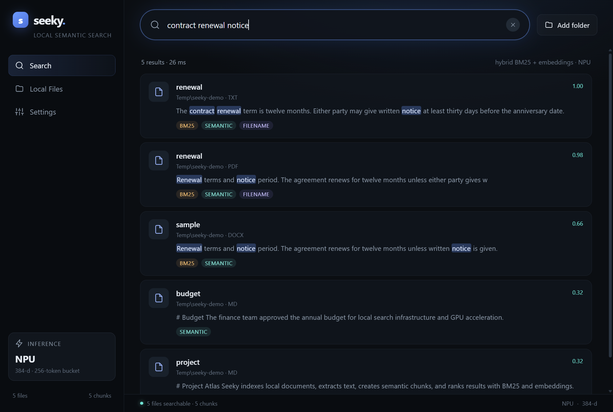

# Seeky

**Find anything. By meaning.**
High-performance neural file search — instant, CPU-first, private, offline.

Seeky is a cross-platform, CPU-first, **local neural information retrieval
engine**, delivered as a lightweight Tauri desktop application. It provides
fast, accurate, multilingual semantic search across your files without a
dedicated GPU, cloud services, or generative language models.

Seeky is built as **a search engine that has a desktop interface — not a
desktop app that has a search engine.**



## Principles

| | |
|---|---|
| **CPU-first** | A dedicated GPU is never required. |
| **NPU-ready** | Optional acceleration on low-power NPUs (Intel, Qualcomm, AMD, Apple). |
| **Local-first** | Content, indexes, and inference stay on your computer. No telemetry. |
| **Performance-first** | Latency and throughput budgets are architecture, not afterthoughts. |
| **Multilingual-first** | Portuguese and English first, without limiting other languages. |
| **Search-only** | No chatbot, agents, MCP, connectors, or generative RAG. |
| **Benchmark-driven** | Every model and index engine is chosen by reproducible bake-off. |
| **Model-agnostic core** | Models can be replaced without rewriting the engine. |

Also: MIT-licensed, no account or license key, slim installer with first-run
model download, light/dark themes, English and Portuguese UI. Full product
definition: [`docs/product/vision.md`](docs/product/vision.md).

## How it searches

```text
query ─► analysis & routing ─► filename · BM25 · dense (parallel) ─► fusion
      ─► document aggregation · near-duplicate collapsing · length correction
      ─► cross-encoder reranking (bounded, adaptive) · diversity
      ─► extractive snippets with highlights
         results stream progressively: Instant → Hybrid → Refined
```

Indexing is two-speed: files become findable by name and words within seconds,
and by meaning as background embedding catches up. See
[`docs/architecture/`](docs/architecture/README.md).

## Status

**0.1.0 — runnable proof of concept** (Windows). Implemented today: Tauri 2 +
React 19 + Rust; PDF/DOCX/XLSX/PPTX/HTML/text extraction; SQLite + FTS5; BM25 +
filename/path + dense retrieval with RRF; live watcher with incremental
reindexing; `gety-embed-v0` embeddings on CPU (ONNX Runtime) and Intel NPU
(OpenVINO). Evidence: [`docs/validation/seeky-poc-validation.md`](docs/validation/seeky-poc-validation.md).

The PoC still reads model/runtime files from a local Gety installation and
bundles a temporary OpenVINO model; both are removed by the provisioning phase.
The road from PoC to 1.0 is in the
[implementation plan](docs/plans/seeky-implementation-plan.md).

## Quick start (PoC)

Prerequisites: Windows 10/11 x64, Node.js 20+, Rust stable (MSVC) with Visual
Studio Build Tools, WebView2, Git LFS, and — for the PoC only — a local Gety
installation providing the model, ONNX Runtime, OpenVINO, and PDFium files
(paths and overrides in [`apps/seeky/README.md`](apps/seeky/README.md)).

```powershell
git lfs install
cd apps\seeky
npm install
npm run tauri dev
```

Smoke test: add `apps\seeky\demo` as a folder, click **Index**, search
`contract renewal notice`, then create/rename/delete a file in that folder and
watch the index update.

## Documentation

| Start here | |
|---|---|
| [`AGENTS.md`](AGENTS.md) | How AI agents and humans work in this repo (SDD + benchmark-driven) |
| [`docs/product/vision.md`](docs/product/vision.md) | Vision, principles, scope, product decisions |
| [`docs/plans/seeky-implementation-plan.md`](docs/plans/seeky-implementation-plan.md) | Phased plan, work packages, gates, status |
| [`docs/architecture/`](docs/architecture/README.md) | Engine architecture, indexing, retrieval, inference, provisioning |
| [`docs/adr/`](docs/adr/README.md) | Architecture decision records |
| [`docs/benchmarks/`](docs/benchmarks/README.md) | Benchmark methodology, budgets, candidates, results |
| [`docs/specs/`](docs/specs/README.md) | Spec process and planned specs |
| [`docs/README.md`](docs/README.md) | Full documentation map |

## Repository layout

```text
apps/seeky/      Tauri + React + Rust PoC (becomes apps/desktop + crates/ in Phase 0)
docs/            product, architecture, ADRs, specs, benchmarks, plans, validation, research
AGENTS.md        agent operating manual (CLAUDE.md imports it)
CONTRIBUTING.md  contributor workflow
NOTICE.md        third-party, clean-room, and privacy notes
```

## Non-goals

Chat, generated answers, agents, MCP, public REST API or CLI, external
connectors, cloud sync, accounts, telemetry, GPU requirements, plugin or theme
marketplaces. Seeky is a precise local search engine, not a RAG platform.

## License

Seeky source code is [MIT-licensed](LICENSE). Third-party libraries, runtimes,
and model weights keep their own licenses — see [`NOTICE.md`](NOTICE.md). No
account or license key is required to use Seeky.
