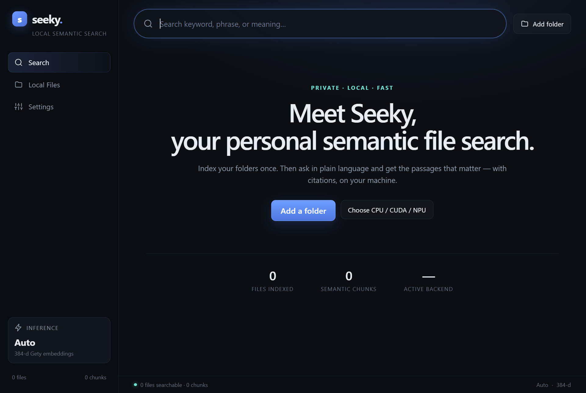
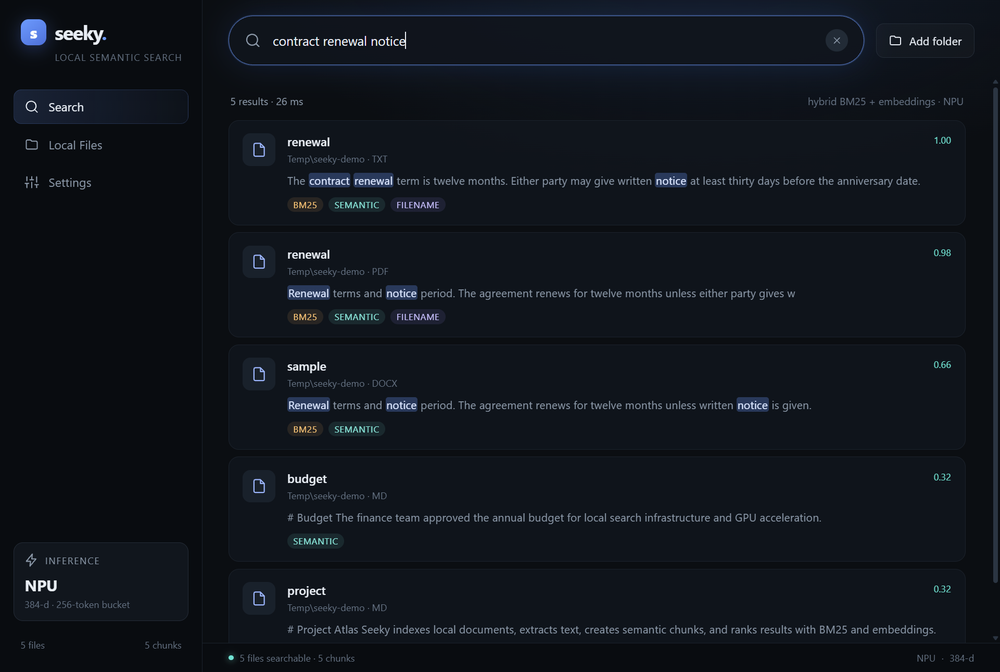

# Seeky

**A Local Neural Information Retrieval Engine and Semantic Desktop Search Engine.**

Seeky is an open-source, local-first desktop application for semantic file
search. It indexes local files, ranks passages and documents with a multilingual
hybrid retrieval pipeline, and shows cited passages. The current PoC is built
from the Gety reverse-engineering research in `docs/research/`.

- Tauri **2.12.7** desktop app
- React 19 + Vite + TypeScript frontend
- Rust backend, SQLite/FTS5, `tokenizers`, ONNX Runtime, OpenVINO
- **CPU and Intel NPU** inference (plus a frozen CUDA path kept only in the PoC; the product is CPU-first and GPU-optional per ADR-0016)
- Live filesystem watching with debounced, incremental per-file reindexing
- MIT-licensed source; no account or commercial license key
- Target: slim first-run provisioning from Cloudflare R2
- Target: light/dark themes and English/Portuguese UI
- Target: SOTA multilingual hierarchical retrieval



See [`docs/product/vision.md`](../../docs/product/vision.md)
for the accepted product direction and [`AGENTS.md`](../../AGENTS.md) for how to work here. The current PoC still depends on a local Gety
installation, ships a temporary OpenVINO IR, and has a dark, English-only UI.

---

## 1. What works now

| Capability | Status |
|---|---|
| Local folder indexing | ✅ |
| TXT / MD / source files | ✅ |
| PDF text extraction (PDFium 7881) | ✅ |
| DOCX text extraction | ✅ |
| HTML / CSV / JSON / XML / YAML text | ✅ |
| XLSX / PPTX extractors compiled | ✅ (not in demo) |
| Sentence embeddings (384-d) | ✅ `gety-embed-v0` |
| BM25 + dense retrieval + RRF | ✅ |
| SQLite persistence + FTS5 | ✅ |
| Incremental re-index with stale-doc pruning | ✅ manual + live watcher |
| Filename/path matching | ✅ third RRF signal |
| Filesystem watcher with debounce | ✅ create / modify / rename / delete |
| Per-folder watch pause/resume | ✅ |
| Index health + cancellation | ✅ |
| CPU inference | ✅ ONNX Runtime uint8 |
| CUDA inference | ✅ ONNX Runtime FP16, RTX 3090 tested |
| NPU inference | ✅ OpenVINO 2026.2 on Intel AI Boost |
| Tauri UI: search, preview, folder manager, backend selector | ✅ |
| Open-source source code (MIT) | ✅ |
| No account or license key | ✅ |
| Slim first-run provisioning | ⏳ target |
| Two themes (light/dark) | ⏳ target |
| English/Portuguese UI | ⏳ target |
| SOTA hierarchical multilingual retrieval | ⏳ target |
| Reranker / pruner / OCR | ⏳ next |

Validated on Windows 11 x64 with an RTX 3090 and Intel AI Boost NPU. The final
release build selected NPU in Settings and searched from the app:
`5 results · 26 ms`, `hybrid BM25 + embeddings · NPU`, status bar
`NPU · 384-d`. Copying only `seeky.exe` + `resources\` to another folder still
resolved the bundled OpenVINO IR and searched in 46 ms. See
[`docs/validation/seeky-poc-validation.md`](../../docs/validation/seeky-poc-validation.md)
for commands and observed output.

---

## 2. Scope

Seeky is a **Local Neural Information Retrieval Engine** and **Semantic Desktop
Search Engine**. It is optimized for retrieval quality, latency, indexing speed,
and computational efficiency.

**In scope:** local filesystem search, multilingual semantic embeddings, hybrid
and hierarchical retrieval, document/passage ranking, RRF, reranking, per-document
limits, near-duplicate handling, cross-document diversity, length-bias correction,
embedded vector storage, live incremental indexing, metadata filters, semantic
snippets, light/dark themes, English/Portuguese UI, and slim first-run
provisioning from Cloudflare R2.

**Out of scope:** accounts, license keys, cloud sync, MCP, public REST API or CLI,
connector SDK/marketplace, external connectors, AI-client integrations, LAN
access, generative chat, agents, multiuser support, plugin marketplaces, and theme
customization.

The full product record is in
[`docs/product/vision.md`](../../docs/product/vision.md).
The target retrieval contract is in
[`docs/architecture/retrieval-engine.md`](../../docs/architecture/retrieval-engine.md).

---

## 3. Architecture

```text
Tauri 2 / React UI
        │ invoke
        ▼
Rust backend
  ├─ db.rs        SQLite: documents, chunks, FTS5, embeddings
  ├─ extract.rs   PDFium / DOCX / XLSX / PPTX / HTML / text
  ├─ indexer.rs   scan → extract → chunk → embed → upsert → prune
  ├─ lib.rs       Tauri commands, notify watcher, index health, cancellation
  ├─ inference.rs CPU (ORT) / CUDA (ORT) / NPU (OpenVINO)
  └─ search.rs    BM25 + filename/path + cosine + RRF → snippets
        │
        ├─ Gety CPU model:  onnx/model_uint8.onnx
        ├─ Gety CUDA model: onnx_cuda/model_fp16.onnx
        └─ Gety OpenVINO IR: resources/.../openvino/model.xml|bin
```

### Retrieval (current PoC)

1. FTS5 BM25 over `chunks_fts` (top 80).
2. Filename/path matching over document titles and paths (top 40).
3. Dense cosine over all stored embeddings (top 80).
4. Reciprocal Rank Fusion (`k = 60`) at chunk level.
5. Snippet + highlights + document metadata.
6. Optional backend switch without re-embedding: vectors are model-compatible
   (384-d Gety model) across CPU/CUDA/NPU.

This is a deliberate improvement over Gety's fixed `0.2 * BM25 + 0.8 * cosine`
score fusion: RRF needs no score calibration.

The **target** SOTA pipeline adds passage reranking, document-level aggregation,
hierarchical retrieval, per-document limits, diversity, near-duplicate handling,
and length-bias correction. See
[`docs/architecture/retrieval-engine.md`](../../docs/architecture/retrieval-engine.md).

---

## 4. Requirements

- Windows 10/11 x64 (PoC target; the code is Tauri-cross-platform)
- Node.js 20+ and npm
- Rust stable (MSVC toolchain) and Visual Studio Build Tools
- WebView2 (installed with Windows 11)
- **Gety installed** at `%LOCALAPPDATA%\Gety` for the current PoC's
  CPU/CUDA model files, PDFium, and runtimes; or set the env vars below.
- NVIDIA driver + CUDA/cuDNN DLLs for CUDA (Gety downloads them under
  `%APPDATA%\ai.gety\data\third_party_libs\cuda`)
- Intel NPU driver + Gety's OpenVINO runtime for NPU

**Target slim setup:** the installed application will not require Gety. Required
runtimes, model weights, tokenizers, and native libraries will be downloaded on
first run from the seeky Cloudflare R2 bucket, verified, and cached for offline
use. See
[`docs/architecture/distribution-and-provisioning.md`](../../docs/architecture/distribution-and-provisioning.md).

Backend availability is determined by model and runtime files. Actual device
support is confirmed when the engine loads; selecting NPU on a machine without
an Intel NPU fails with a clear error instead of silently falling back.

### Model resolution

| Purpose | Path | Override |
|---|---|---|
| CPU/CUDA + tokenizer | `%APPDATA%\ai.gety\data\models\gety-ai\gety-embed-v0\<rev>` | `SEEKY_GETY_MODEL_DIR` |
| ONNX Runtime | `%APPDATA%\ai.gety\data\ep\onnxruntime.dll` | `SEEKY_ORT_DLL` |
| OpenVINO runtime | `%APPDATA%\ai.gety\data\third_party_libs\openvino` | `SEEKY_OPENVINO_DIR` |
| PDFium | `%LOCALAPPDATA%\Gety\lib\pdfium.dll` | `SEEKY_PDFIUM_DLL` |
| NPU IR | bundled in `src-tauri/resources/models/gety-embed-v0/openvino` | `SEEKY_NPU_DIR` |

The 118.6 MB OpenVINO IR is temporarily included under
`src-tauri/resources/models` so the current NPU path works without a download.
CPU/CUDA model files are read from the local Gety installation. This is
transitional; the target slim setup downloads verified assets from R2 and
removes the bundled IR.

---

## 5. Run

```powershell
cd apps\desktop
npm install
npm run tauri dev
```

Production-style build:

```powershell
npm run tauri -- build --no-bundle
# binary: <repo>\target\release\seeky.exe (workspace target directory)
```

Run it from `<repo>\target\release`, or copy `seeky.exe` together with the
`resources\` directory. The release build places the NPU IR under
`target\release\resources\models\gety-embed-v0\openvino`. The validated release
binary is 11.5 MB (plus the 118.6 MB bundled OpenVINO `model.bin`).

Debug build:

```powershell
npm run tauri -- build --debug --no-bundle
# binary: <repo>\target\debug\seeky.exe
```

### Use

1. **Add folder** → choose a folder. Seeky starts watching it immediately. For
   a quick smoke test, choose this repository's `apps/desktop/demo` folder.
2. **Local Files** → **Index** once to build the initial index.
3. From then on, create/edit/rename/delete files normally; the watcher applies
   changes after a short debounce and updates the health panel.
4. Use **Watching / Paused** on each folder to enable or pause live updates.
5. Use **Reindex** to pick up edits made while Seeky was closed, or to repair a
   folder after extraction errors. Unchanged files are skipped by size+mtime.
6. Type a natural-language or keyword query, for example
   `contract renewal notice`. Filename and path terms are matched too and show
   a `FILENAME` tag.
7. Click a result to preview; **Open file** launches the OS default app.
8. **Settings** → choose Auto / CPU / CUDA / NPU. Auto uses the CPU only: it
   selects validated providers (ADR-0016), and the NPU path is not validated
   yet. NPU and CUDA must be chosen explicitly. The choice is
   saved and reused on the next launch.
9. Switching backends does not re-embed the index. All backends produce 384-d
   `gety-embed-v0` vectors, but cross-backend parity is **not verified** (the
   NPU path truncates passages at 256 tokens versus 512 on CPU), so an index
   built on one backend and queried on another may rank differently. Known
   deviation from ADR-0019 until index generations land (plan WP-2.1, WP-3.7);
   see the [conformance audit](../../docs/validation/poc-conformance-audit.md).

While indexing, the status bar and **Index health** panel show progress; use
**Cancel** to stop after the current file.



More captures: [NPU settings](../../docs/assets/screenshots/seeky/settings-npu.png) ·
[preview](../../docs/assets/screenshots/seeky/preview.png) ·
[local files](../../docs/assets/screenshots/seeky/files.png).

---

## 6. Tests

```powershell
cargo test --workspace   # from the repository root
```

The default run is hardware-free. Tests that need local Gety model files,
PDFium, CUDA, or an Intel NPU are ignored unless the `hw-tests` feature is on:

```powershell
cargo test --workspace --features hw-tests -- --test-threads=1 --nocapture
```

With `hw-tests` on a machine that has those assets, all 9 tests pass. Covers
CPU/CUDA/NPU embeddings, PDF/DOCX/HTML extraction, incremental index/search roundtrip (create, modify, rename, delete,
unchanged skip), and watcher event mapping. The release binary was also
smoke-tested end-to-end on the NPU, including a portable `exe + resources`
copy. See
[`docs/validation/seeky-poc-validation.md`](../../docs/validation/seeky-poc-validation.md).

---

## 7. Technical notes

- **Chunking:** ~1,200 characters, 200-character overlap, boundary-aware.
- **Embeddings:** `gety-embed-v0`, 384-d, 512 tokens, L2-normalized.
- **Storage:** one SQLite file per user data dir; FTS5 external-content table
  kept in sync with triggers; vectors stored as f32 BLOBs.
- **NPU:** OpenVINO IR reshaped to `[1, 256]`, `<pad>` id 1, in-graph attention
  mask, compiled once per process. First compile can take tens of seconds.
- **CUDA:** Gety FP16 ONNX, output `embeddings` as f16, converted to f32.
- **CPU:** Gety uint8 ONNX, output `sentence_embedding`.
- **PDF:** PDFium 7881 via `pdfium-render` `pdfium_7881` feature.
- **Watcher:** `notify` recursive watcher per folder, 600 ms debounce, event
  dedupe by path, rename handling (both/from/to), and directory scans when a
  whole folder is created or renamed. Search keeps running while indexing.
- **Incremental indexing:** size + nanosecond mtime signatures; unchanged files
  are skipped. A full Reindex also prunes documents whose files disappeared.
- **Permissions:** the webview gets only Tauri core + dialog capabilities.
  Opening a file is a narrow Rust command, not a broad `opener` path allowlist.
- **Privacy:** the current PoC has no outbound network calls or analytics. The
  target slim setup uses network only for approved R2 asset provisioning.
- **License:** Seeky source is MIT-licensed. No account, activation, or commercial
  license key is required. Third-party assets keep their own licenses.
- **Target models:** the current `gety-embed-v0` integration is a compatibility
  baseline. Multilingual model selection is benchmark-gated; see
  [`docs/architecture/inference-and-models.md`](../../docs/architecture/inference-and-models.md)
  and [`docs/benchmarks/candidates.md`](../../docs/benchmarks/candidates.md).

### Gety materials and licenses

- Seeky source code is **MIT-licensed**; see [`LICENSE`](../../LICENSE).
- No account, activation, or commercial license key is required.
- `gety-embed-v0` model card declares **MIT**:
  <https://huggingface.co/gety-ai/gety-embed-v0>
- The Gety application itself is proprietary; Seeky reads the installed model
  files locally and does not redistribute Gety binaries.
- The temporary OpenVINO IR in `resources/` is the published
  `gety-ai/gety-embed-v0` OpenVINO export. Verify the model license before
  redistribution.
- Gety's OCR weights are encrypted/private and are **not** used by Seeky.

---

## 8. Next steps

This PoC is the starting point of the
[implementation plan](../../docs/plans/seeky-implementation-plan.md). Phase 0
moves this code into an engine-first Cargo workspace (`crates/` + `apps/desktop`)
without behavior changes; Phase 1 adds the evaluation harness and measures this
PoC as baseline B0.

---

## 9. Repository layout

```text
apps/desktop/
  demo/                five-file smoke-test corpus (TXT/MD/PDF/DOCX)
  src/                 React UI
  src-tauri/
    src/
      lib.rs           Tauri commands, watcher worker, index health
      inference.rs     CPU/CUDA/NPU engine
      indexer.rs       scan/extract/chunk/embed/store, incremental skip
      extract.rs       format extractors
      db.rs            SQLite schema/repository, signatures, filename index
      search.rs        BM25 + filename/path + dense + RRF
    resources/models/  NPU OpenVINO IR
    tests/fixtures/    generated PDF/DOCX fixtures
```

Project documentation lives under [`docs/`](../../docs/README.md).
