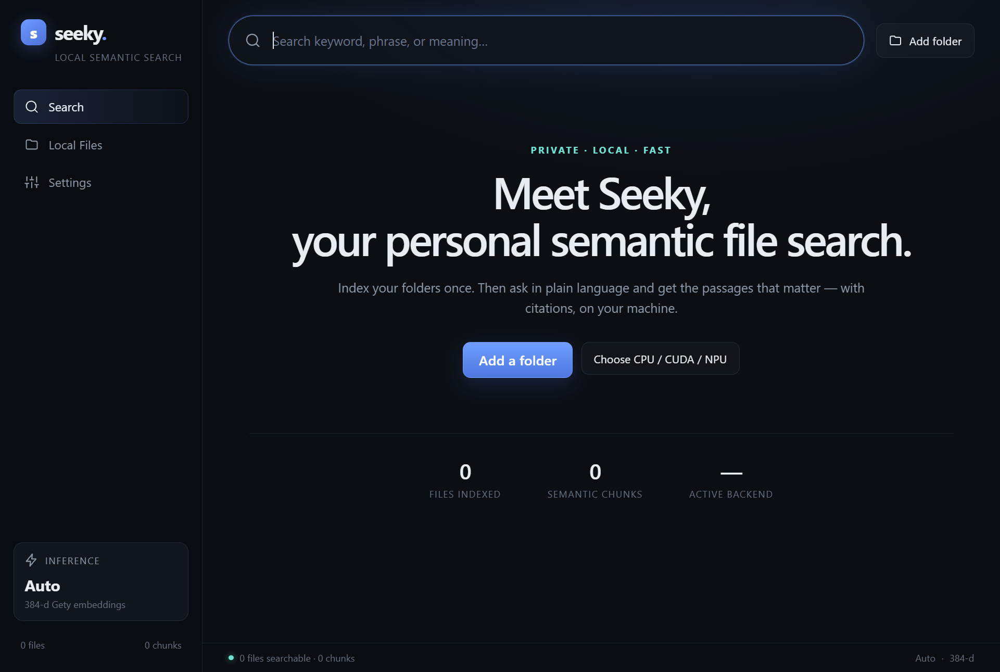
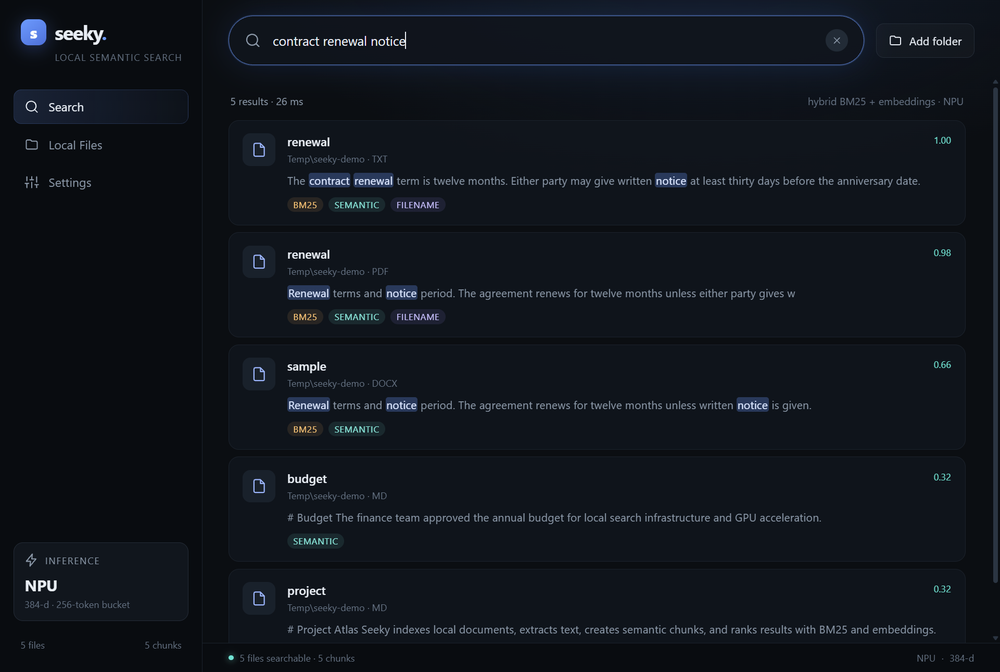

# Seeky

**A high-performance, local-first semantic file search engine. No cloud, no chatbots, no agents. Just search.**

Seeky is the first PoC built from the Gety reverse-engineering notes in
`docs/research/`. It is intentionally narrow: index local files, embed their chunks
with Gety's published embedding model, retrieve with BM25 + filename/path + dense
vectors + RRF, and show cited passages.

- Tauri **2.12.7** desktop app (latest 2.x line)
- React 19 + Vite + TypeScript frontend
- Rust backend, SQLite/FTS5, `tokenizers`, ONNX Runtime, OpenVINO
- **CPU, CUDA and Intel NPU** inference using `gety-embed-v0`
- Live filesystem watching with debounced, incremental per-file reindexing
- PDF, DOCX, TXT, Markdown, HTML, CSV, JSON and source-code extraction
- No network calls, no telemetry, no connectors, no MCP, no chat



---

## 1. What works now

| Capability | Status |
|---|---|
| Local folder indexing | ✅ |
| TXT / MD / source files | ✅ |
| PDF text extraction (PDFium 7881) | ✅ |
| DOCX text extraction | ✅ |
| HTML / CSV / JSON / XML / YAML text | ✅ |
| XLSX / PPTX extractors compiled | ✅ (not in demo) |
| Sentence embeddings (384-d) | ✅ `gety-embed-v0` |
| BM25 + dense retrieval + RRF | ✅ |
| SQLite persistence + FTS5 | ✅ |
| Incremental re-index with stale-doc pruning | ✅ manual + live watcher |
| Filename/path matching | ✅ third RRF signal |
| Filesystem watcher with debounce | ✅ create / modify / rename / delete |
| Per-folder watch pause/resume | ✅ |
| Index health + cancellation | ✅ |
| CPU inference | ✅ ONNX Runtime uint8 |
| CUDA inference | ✅ ONNX Runtime FP16, RTX 3090 tested |
| NPU inference | ✅ OpenVINO 2026.2 on Intel AI Boost |
| Tauri UI: search, preview, folder manager, backend selector | ✅ |
| Reranker / pruner / OCR | ⏳ next |

Validated on Windows 11 x64 with an RTX 3090 and Intel AI Boost NPU. The final
release build selected NPU in Settings and searched from the app:
`5 results · 26 ms`, `hybrid BM25 + embeddings · NPU`, status bar
`NPU · 384-d`. Copying only `seeky.exe` + `resources\` to another folder still
resolved the bundled OpenVINO IR and searched in 46 ms. See
[`docs/validation/seeky-poc-validation.md`](../../docs/validation/seeky-poc-validation.md)
for commands and observed output.

---

## 2. Scope (from `docs/product/seeky-scope.md`)

**In:** local filesystem search, semantic embeddings, hybrid retrieval, RRF,
embedded vector storage, incremental live indexing, metadata filters via
paths/extensions, semantic snippets, progressive-ish result rendering,
cross-platform desktop.

**Out:** MCP, public REST API, public CLI, connector SDK/marketplace, external
connectors, cloud sync, AI-client integrations, API keys, LAN access, chat,
generative LLM, multiuser, plugins.

Seeky keeps the retrieval core and drops the platform around it.

The PoC now covers indexing, live incremental updates, hybrid retrieval, RRF,
storage and preview. Metadata filters, progressive rendering and reranking are
in scope but remain next steps.

---

## 3. Architecture

```text
Tauri 2 / React UI
        │ invoke
        ▼
Rust backend
  ├─ db.rs        SQLite: documents, chunks, FTS5, embeddings
  ├─ extract.rs   PDFium / DOCX / XLSX / PPTX / HTML / text
  ├─ indexer.rs   scan → extract → chunk → embed → upsert → prune
  ├─ lib.rs       Tauri commands, notify watcher, index health, cancellation
  ├─ inference.rs CPU (ORT) / CUDA (ORT) / NPU (OpenVINO)
  └─ search.rs    BM25 + filename/path + cosine + RRF → snippets
        │
        ├─ Gety CPU model:  onnx/model_uint8.onnx
        ├─ Gety CUDA model: onnx_cuda/model_fp16.onnx
        └─ Gety OpenVINO IR: resources/.../openvino/model.xml|bin
```

### Retrieval

1. FTS5 BM25 over `chunks_fts` (top 80).
2. Filename/path matching over document titles and paths (top 40).
3. Dense cosine over all stored embeddings (top 80).
4. Reciprocal Rank Fusion (`k = 60`) at chunk level.
5. Snippet + highlights + document metadata.
6. Optional backend switch without re-embedding: vectors are model-compatible
   (384-d Gety model) across CPU/CUDA/NPU.

This is a deliberate improvement over Gety's fixed `0.2 * BM25 + 0.8 * cosine`
score fusion: RRF needs no score calibration.

---

## 4. Requirements

- Windows 10/11 x64 (PoC target; the code is Tauri-cross-platform)
- Node.js 20+ and npm
- Rust stable (MSVC toolchain) and Visual Studio Build Tools
- WebView2 (installed with Windows 11)
- **Gety installed** at `C:\Users\bernh\AppData\Local\Gety` for CPU/CUDA model
  files and PDFium; or set the env vars below.
- NVIDIA driver + CUDA/cuDNN DLLs for CUDA (Gety downloads them under
  `%APPDATA%\ai.gety\data\third_party_libs\cuda`)
- Intel NPU driver + Gety's OpenVINO runtime for NPU

Backend availability is determined by model and runtime files. Actual device
support is confirmed when the engine loads; selecting NPU on a machine without
an Intel NPU fails with a clear error instead of silently falling back.

### Model resolution

| Purpose | Path | Override |
|---|---|---|
| CPU/CUDA + tokenizer | `%APPDATA%\ai.gety\data\models\gety-ai\gety-embed-v0\<rev>` | `SEEKY_GETY_MODEL_DIR` |
| ONNX Runtime | `%APPDATA%\ai.gety\data\ep\onnxruntime.dll` | `SEEKY_ORT_DLL` |
| OpenVINO runtime | `%APPDATA%\ai.gety\data\third_party_libs\openvino` | `SEEKY_OPENVINO_DIR` |
| PDFium | `%LOCALAPPDATA%\Gety\lib\pdfium.dll` | `SEEKY_PDFIUM_DLL` |
| NPU IR | bundled in `src-tauri/resources/models/gety-embed-v0/openvino` | `SEEKY_NPU_DIR` |

The 119 MB OpenVINO IR is included under `src-tauri/resources/models` so the
NPU path works without a download. CPU/CUDA model files are read from the local
Gety installation and are not duplicated.

---

## 5. Run

```powershell
cd apps\seeky
npm install
npm run tauri dev
```

Production-style build:

```powershell
npm run tauri -- build --no-bundle
# binary: src-tauri\target\release\seeky.exe
```

Run it from `src-tauri\target\release`, or copy `seeky.exe` together with the
`resources\` directory. The release build places the NPU IR under
`target\release\resources\models\gety-embed-v0\openvino`. The validated release
binary is 11.5 MB (plus the 118.6 MB bundled OpenVINO `model.bin`).

Debug build:

```powershell
npm run tauri -- build --debug --no-bundle
# binary: src-tauri\target\debug\seeky.exe
```

### Use

1. **Add folder** → choose a folder. Seeky starts watching it immediately. For
   a quick smoke test, choose this repository's `apps/seeky/demo` folder.
2. **Local Files** → **Index** once to build the initial index.
3. From then on, create/edit/rename/delete files normally; the watcher applies
   changes after a short debounce and updates the health panel.
4. Use **Watching / Paused** on each folder to enable or pause live updates.
5. Use **Reindex** to pick up edits made while Seeky was closed, or to repair a
   folder after extraction errors. Unchanged files are skipped by size+mtime.
6. Type a natural-language or keyword query, for example
   `contract renewal notice`. Filename and path terms are matched too and show
   a `FILENAME` tag.
7. Click a result to preview; **Open file** launches the OS default app.
8. **Settings** → choose Auto / CPU / CUDA / NPU. Auto resolves
   CUDA → NPU → CPU. The choice is saved and reused on the next launch.
9. Switching backends does not re-embed the index: CPU, CUDA and NPU all use
   compatible 384-d `gety-embed-v0` vectors.

While indexing, the status bar and **Index health** panel show progress; use
**Cancel** to stop after the current file.



More captures: [NPU settings](../../docs/assets/screenshots/seeky/settings-npu.png) ·
[preview](../../docs/assets/screenshots/seeky/preview.png) ·
[local files](../../docs/assets/screenshots/seeky/files.png).

---

## 6. Tests

```powershell
cd apps\seeky\src-tauri
cargo test --lib -- --test-threads=1 --nocapture
```

Current result: **8 passed**. Covers CPU/CUDA/NPU embeddings, PDF/DOCX
extraction, incremental index/search roundtrip (create, modify, rename, delete,
unchanged skip), and watcher event mapping. The release binary was also
smoke-tested end-to-end on the NPU, including a portable `exe + resources`
copy. See
[`docs/validation/seeky-poc-validation.md`](../../docs/validation/seeky-poc-validation.md).

---

## 7. Technical notes

- **Chunking:** ~1,200 characters, 200-character overlap, boundary-aware.
- **Embeddings:** `gety-embed-v0`, 384-d, 512 tokens, L2-normalized.
- **Storage:** one SQLite file per user data dir; FTS5 external-content table
  kept in sync with triggers; vectors stored as f32 BLOBs.
- **NPU:** OpenVINO IR reshaped to `[1, 256]`, `<pad>` id 1, in-graph attention
  mask, compiled once per process. First compile can take tens of seconds.
- **CUDA:** Gety FP16 ONNX, output `embeddings` as f16, converted to f32.
- **CPU:** Gety uint8 ONNX, output `sentence_embedding`.
- **PDF:** PDFium 7881 via `pdfium-render` `pdfium_7881` feature.
- **Watcher:** `notify` recursive watcher per folder, 600 ms debounce, event
  dedupe by path, rename handling (both/from/to), and directory scans when a
  whole folder is created or renamed. Search keeps running while indexing.
- **Incremental indexing:** size + nanosecond mtime signatures; unchanged files
  are skipped. A full Reindex also prunes documents whose files disappeared.
- **Permissions:** the webview gets only Tauri core + dialog capabilities.
  Opening a file is a narrow Rust command, not a broad `opener` path allowlist.
- **Privacy:** no outbound network calls or analytics.

### Gety materials and licenses

- `gety-embed-v0` model card declares **MIT**:
  <https://huggingface.co/gety-ai/gety-embed-v0>
- The Gety application itself is proprietary; Seeky reads the installed model
  files locally and does not redistribute Gety binaries.
- The OpenVINO IR in `resources/` is the published `gety-ai/gety-embed-v0`
  OpenVINO export. Verify the model license before redistribution.
- Gety's OCR weights are encrypted/private and are **not** used by Seeky.

---

## 8. Next steps

1. Add a cross-encoder reranker (Qwen3-Reranker-0.6B or bge-reranker-v2-m3)
   over the RRF top 30.
2. Add a heuristic pruner (dedupe/MMR/token budget) and a future learned pruner.
3. Add metadata filters (folder, extension, modified date) to the UI.
4. Add XLSX/PPTX fixtures and richer PDF page metadata.
5. Add `sqlite-vec`/USearch only if exact cosine stops meeting latency targets.
6. Add an optional extractive/LLM answer layer (see the parent docs).

---

## 9. Repository layout

```text
apps/seeky/
  demo/                five-file smoke-test corpus (TXT/MD/PDF/DOCX)
  src/                 React UI
  src-tauri/
    src/
      lib.rs           Tauri commands, watcher worker, index health
      inference.rs     CPU/CUDA/NPU engine
      indexer.rs       scan/extract/chunk/embed/store, incremental skip
      extract.rs       format extractors
      db.rs            SQLite schema/repository, signatures, filename index
      search.rs        BM25 + filename/path + dense + RRF
    resources/models/  NPU OpenVINO IR
    tests/fixtures/    generated PDF/DOCX fixtures
```

Project documentation lives under [`docs/`](../../docs/README.md).
