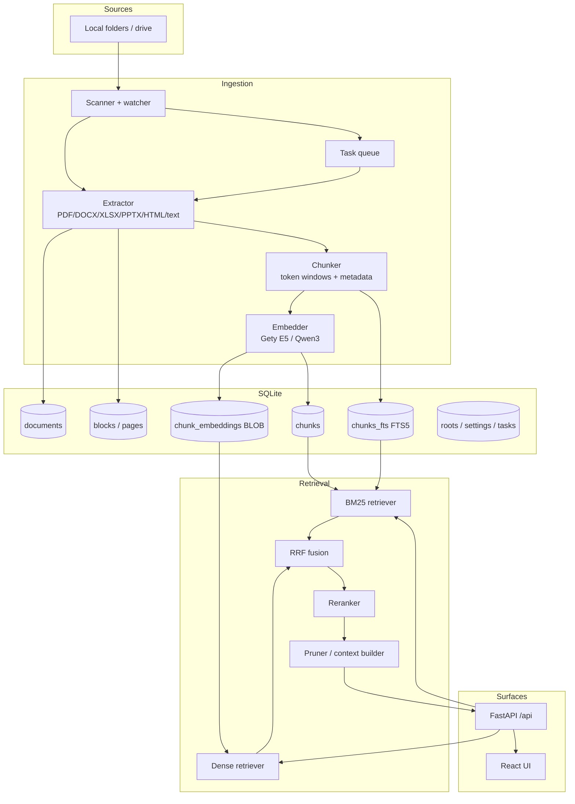

> **Archived — superseded.** This document is historical research. The active Seeky implementation is Rust/Tauri/TypeScript; see [../plans/seeky-implementation-plan.md](../plans/seeky-implementation-plan.md).

# 03 — Minimal RAG App Blueprint

**Goal:** a local-first desktop/web app that indexes a user's files and answers
search queries with hybrid retrieval, RRF, and a cross-encoder reranker. No
connectors, no AI-client integrations, no accounts, no cloud sync.

**Scope:** local files only (folders and optionally one NTFS volume), extraction,
chunking, embeddings, BM25, dense retrieval, fusion, reranking, optional
pruning, preview/citations.

**Non-goals for v1:** cloud connectors, MCP/REST exposure to external AI tools,
connector marketplace, OCR model training, multi-user/server deployment,
billing, auto-update, mobile.

**Optional extension:** answer synthesis (full RAG) over the retrieved context.
It is deliberately separated into [`10-answer-generation.md`](answer-generation-python.md)
so you can ship search-only first and add a local LLM later.

---

## 1. Design principles

1. **SQLite is the source of truth.** Documents, extracted blocks, chunks,
   FTS5 and vectors all live in one portable database. No separate vector
   service is required for the first version.
2. **Two independent retrievers, one fusion layer.** BM25 and dense retrieval
   must be independently debuggable. Do not hide one inside the other.
3. **RRF first, learned reranking second.** RRF is cheap, robust, and gives a
   strong baseline. A cross-encoder is an optional second stage over a small
   candidate set.
4. **Every result is explainable.** Return document ID, page/block, byte
   offsets, snippet, and which retriever(s) found it.
5. **No model lock-in.** Embeddings carry `model_id`, `dim`, `version`, and
   `normalized` metadata. Re-embedding is a background migration, not a schema
   rewrite.
6. **Measure before optimizing.** Exact cosine is allowed to be slower than ANN
   until the corpus and latency targets demand otherwise.

---

## 2. Recommended stack

### 2.1 Fast path (recommended for v1)

| Layer | Choice | Why |
|---|---|---|
| Backend | **Python 3.11/3.12 + FastAPI + Uvicorn** | Fast iteration on extraction, chunking, embeddings, rerankers; rich ML ecosystem. |
| DB | **SQLite** (stdlib `sqlite3` or `SQLAlchemy` Core) + FTS5 | Same class of engine as Gety; zero-ops; single file. |
| Embeddings | **ONNX Runtime** + `tokenizers` for `gety-embed-v0`; later `sentence-transformers`/Transformers for Qwen3 | Gety model already installed; ONNX CPU is fast enough; GPU optional. |
| Reranker | `sentence-transformers.CrossEncoder` (Qwen3-Reranker-0.6B) later | Simple API; can switch to Transformers/ONNX for production. |
| Extraction | `pymupdf` or `pypdf`+`pdfplumber`, `python-docx`, `openpyxl`, `python-pptx`, `beautifulsoup4`/`lxml`, `charset-normalizer` | Covers the formats Gety supports. Check licenses (PyMuPDF is AGPL; `pypdf`/`pdfplumber` are BSD/MIT). |
| File watching | `watchdog` | Cross-platform incremental updates. |
| Frontend | **React 19 + Vite + TypeScript + Tailwind + Radix/shadcn + TanStack Query** | Closest to Gety's UI stack; fast to build. |
| Desktop shell (optional) | **Tauri 2** wrapping the local web UI | Small binary, WebView2/WebKitGTK, matches Gety. A browser tab is enough for the first demo. |
| OCR (optional) | RapidOCR / PaddleOCR / Tesseract | Gety's OCR weights are encrypted and not reusable; use an open engine. |

### 2.2 Rust path (production option, later)

If you need a single small binary and tight latency, port the stable interfaces
to:

- `axum` + `tokio` for the local API.
- `rusqlite` + FTS5 for storage.
- `ort` for ONNX Runtime.
- `tokenizers` for the embedding tokenizer.
- `notify` for filesystem events.
- Tauri 2 for the shell.

This is essentially Gety's architecture, minus connectors/integrations. It is
more work; do it only after the Python version has a validated retrieval
quality loop.

---

## 3. High-level architecture



---

## 4. Component contracts

### 4.1 Scanner

Inputs: root path, include/exclude globs, file-type policy.

Outputs: upsert/delete events for `documents`.

Rules:

- Skip hidden/system/temp by default; allow overrides.
- Stable document ID: `sha256(root_id + ":" + relative_path)` (or a UUID in the
  DB with a unique `(root_id, rel_path)`).
- Change detection: `(size, mtime_ns)` fast path; content hash (BLAKE3/SHA-256)
  when metadata changes.
- Ignore its own data directory and model/cache directories.
- Handle renames as delete + insert (or map by inode/file ID later).
- Network shares: offer periodic rescan instead of relying on watcher events.

### 4.2 Extractor

Interface:

```python
def extract(path: Path) -> ExtractedDoc:
    """Return text + layout blocks + metadata. Never raise for unsupported files."""
```

`ExtractedDoc`:

```python
@dataclass
class Block:
    kind: str          # paragraph, heading, table, cell, image, page
    text: str
    page: int | None
    bbox: tuple[float, float, float, float] | None
    byte_start: int | None
    byte_end: int | None
    sheet: int | None
    row: int | None
    col: int | None

@dataclass
class ExtractedDoc:
    title: str
    text: str
    blocks: list[Block]
    metadata: dict
    content_format: str  # plaintext | markdown
```

Recommended extractors:

| Format | Library | Notes |
|---|---|---|
| PDF | `pymupdf` (fast, AGPL) or `pypdf` + `pdfplumber` | Keep page numbers and word/line boxes for highlights. |
| DOCX | `python-docx` | Headings, paragraphs, tables; comments optional. |
| XLSX | `openpyxl` | Sheet name, cell coordinates, formula/value. Store cell anchors. |
| PPTX | `python-pptx` | Slide number, shape text. |
| HTML | `beautifulsoup4` + `lxml` | Strip nav/script; preserve headings/links. |
| TXT/MD/CSV | stdlib + `charset-normalizer` | Detect encoding; normalize newlines. |
| Images | RapidOCR/PaddleOCR/Tesseract | Optional; store OCR text as blocks with bbox. |

Failure policy: store `extraction_status = failed` with an error string; never
block the queue.

### 4.3 Chunker

Interface:

```python
def chunk(doc: ExtractedDoc, max_tokens=512, overlap=64) -> list[Chunk]
```

Rules:

- Tokenize with the embedding model's tokenizer (or a cheap approximate
  tokenizer for speed); split on paragraph/heading boundaries first.
- Target 400–512 tokens, 64–96 overlap. Tables should not be split mid-row if
  possible; keep a header row repeated in each table chunk.
- Store:
  - `doc_id`, `ordinal`
  - `text`
  - `token_count`
  - `page_start`, `page_end`
  - `block_start`, `block_end`
  - `byte_start`, `byte_end`
  - `content_hash`
  - `embedding_model`, `embedding_dim`, `embedding_version`
- Keep the original block IDs/offsets so the UI can highlight the exact source.

### 4.4 Embedder

Interface:

```python
class Embedder:
    model_id: str
    dim: int
    def encode(self, texts: list[str], kind: Literal["query", "passage"]) -> np.ndarray: ...
```

Rules:

- Normalize vectors to unit length; store `float32` little-endian BLOB.
- Batch 16–64; truncate to model max length (512 for `gety-embed-v0`).
- Store `model_id`, `dim`, `version`, `normalized=1` per chunk or in a model
  registry.
- On model change, mark old chunks `embedding_status = stale` and re-embed in
  the background; do not mix dimensions in one query.
- For `gety-embed-v0`, use `input_ids` + `attention_mask`; output
  `sentence_embedding` (pooling/normalization are already in the graph).
- Test E5 prefixes (`query: ` / `passage: `) against no-prefix; Gety's exact
  formatting is unknown. Pick the better result on your evaluation set and
  record it.

### 4.5 Store

See [`04-data-model-and-storage.md`](../research/data-model-and-storage.md) and
[`sql/minimal_rag_schema.sql`](../../sql/minimal-schema.sql).

Minimum tables:

- `roots`
- `documents`
- `blocks`
- `chunks`
- `chunks_fts` (FTS5)
- `chunk_embeddings` (or `embedding` on `chunks`)
- `index_tasks`
- `settings`

### 4.6 Lexical retriever

```sql
SELECT rowid, bm25(chunks_fts) AS score
FROM chunks_fts
WHERE chunks_fts MATCH ?
ORDER BY score
LIMIT ?;
```

- Use FTS5 `unicode61` or a custom tokenizer for your language mix.
- Quote user input safely; support phrases and prefix queries.
- Add `jieba`/pinyin only if the corpus is Chinese-heavy; Gety does, but it is
  not required for v1.
- Return `(chunk_id, rank)`; do not expose the raw BM25 score as a probability.

### 4.7 Dense retriever

Phase 1 (exact):

```python
# Fetch candidate vectors (optionally filtered by root/type/date).
candidates = load_candidate_vectors(conn, filters)
scores = candidates_matrix @ query_vector
top = np.argpartition(-scores, k)[:k]
```

- Candidate filters matter: root, file type, update time, and a maximum
  candidate count.
- For 100k chunks at 384-d f32, the matrix is ~150 MB; loading it per query is
  too slow. Cache it in memory or use a memory-mapped matrix.
- For 1M chunks, use ANN (Phase 2).

Phase 2 (ANN options):

| Option | Fit |
|---|---|
| `sqlite-vec` (`vec0`) | Single-file SQLite extension; easiest migration; metadata filtering in SQL. |
| `usearch` / `hnswlib` | Fast in-process HNSW; persist index alongside SQLite. |
| Qdrant / LanceDB | Separate service; overkill for a desktop app but useful if you outgrow one process. |

Recommendation: **sqlite-vec** as the first ANN step because it keeps the
single-file property; keep SQLite as the source of truth and rebuild the ANN
index from it.

### 4.8 Fusion (RRF)

```python
def rrf(rankings: list[list[int]], k: int = 60, weights=None) -> list[tuple[int, float]]:
    scores = defaultdict(float)
    for i, ranking in enumerate(rankings):
        w = weights[i] if weights else 1.0
        for rank, doc_id in enumerate(ranking, start=1):
            scores[doc_id] += w / (k + rank)
    return sorted(scores.items(), key=lambda x: -x[1])
```

- Fuse at **chunk** level, then aggregate to document level for display.
- Default `k=60`; document-level dedupe by best chunk + max 3 chunks per doc.
- Keep a debug field `retrievers: ["bm25", "dense"]` and per-retriever ranks.
- If one retriever is disabled, RRF degenerates to that ranking; do not mix
  raw BM25 and cosine scores.

### 4.9 Reranker

Input: query + top 20–50 chunks from RRF.

Recommended models:

| Model | Size | Notes |
|---|---|---|
| `Qwen/Qwen3-Reranker-0.6B` | 0.6B, 32k context | Strong multilingual; instruction-aware; Apache-2.0. |
| `BAAI/bge-reranker-v2-m3` | 0.6B | Strong multilingual baseline. |
| `jinaai/jina-reranker-v2-base-multilingual` | 0.3B | Lower latency. |

Implementation:

```python
from sentence_transformers import CrossEncoder
reranker = CrossEncoder("Qwen/Qwen3-Reranker-0.6B")
scores = reranker.predict([(query, chunk.text) for chunk in candidates])
```

- Batch 8–16; cap sequence length (e.g., 1024–2048 tokens for reranking).
- Normalize/convert scores only for display; rank by raw score.
- Blend with RRF only if evaluation shows a benefit:
  `final = 0.7 * sigmoid(rerank) + 0.3 * rrf_norm`.
- Rerank only top 20–50; reranking 1,000 candidates is wasted latency.
- Add a timeout/fallback: if the reranker is unavailable or slow, return RRF
  order and mark `reranked=false`.

### 4.10 Pruner / context builder

Gety has no neural pruner; snippets are heuristics. Build an interface, not a
model, first:

```python
class Pruner:
    def prune(self, query: str, candidates: list[Passage], token_budget: int) -> list[Passage]: ...
```

Baseline:

1. Deduplicate near-identical chunks (content hash / MinHash / cosine).
2. Keep at most 2–3 chunks per document.
3. Expand around the best match (neighbor paragraphs) within the token budget.
4. MMR for diversity (`lambda=0.7`) when the user asks a broad question.
5. Hard token budget for the downstream LLM context.

Future learned pruner:

- A small classifier that scores “is this passage necessary to answer the
  query?” on `(query, passage)` pairs.
- Train on query–passage–answer triples or weak labels from reranker scores.
- Keep it optional and behind a flag; measure nDCG and answer quality before
  enabling.

Do not call the Q4 embedding-index pruning code “context pruning”; it is
embedding-index maintenance.

---

## 5. End-to-end flows

### 5.1 Add a folder / initial index

1. User selects a folder; create a `roots` row.
2. Scanner walks the tree, inserts `documents` with `status=pending`.
3. Content workers extract text/blocks; update `documents.status=extracted`.
4. Chunker creates `chunks`; FTS insert per chunk.
5. Embedding workers fill `chunk_embeddings`; mark `embedded`.
6. UI shows progress: discovered / extracted / embedded / failed.

Make the stages independently searchable, like Gety's Fast search / Content
search / AI indexing: title/metadata results can appear first, FTS as extraction
completes, and semantic only after embeddings exist. Do not block the UI until
the whole corpus is embedded.

### 5.2 Incremental update

1. Watcher receives create/modify/delete.
2. Debounce (500–1000 ms) and coalesce per path.
3. On modify: compare size/mtime/hash; if unchanged, skip.
4. Delete old blocks/chunks/embeddings (or mark stale), re-extract.
5. Re-embed only changed chunks; keep stable chunk IDs if possible.

### 5.3 Search

1. Validate/normalize query; parse filters.
2. BM25 top 100 + dense top 100 (parallel).
3. RRF fuse; dedupe by doc; keep top 50 chunks.
4. Rerank top 30; optionally blend.
5. Prune/expand to token budget; build snippets + highlights.
6. Return documents with citations and debug ranks.

### 5.4 Open/preview

1. `GET /api/docs/{id}` returns metadata + blocks + chunk offsets.
2. `GET /api/docs/{id}/file` streams original bytes (local only).
3. UI renders PDF/DOCX/spreadsheet preview and scrolls to the best block.

---

## 6. Configuration defaults

```yaml
index:
  roots: []
  include: ["**/*"]
  exclude:
    - "**/.git/**"
    - "**/node_modules/**"
    - "**/.cache/**"
    - "**/AppData/**"
  max_file_mb: 100
  follow_symlinks: false
  ocr: false

chunking:
  max_tokens: 512
  overlap_tokens: 64
  min_chars: 40

embedding:
  provider: onnx
  model: gety-embed-v0
  dim: 384
  max_length: 512
  batch_size: 32
  normalize: true
  query_prefix: ""      # test "query: " / "passage: "
  passage_prefix: ""

retrieval:
  bm25_top_k: 100
  dense_top_k: 100
  rrf_k: 60
  rrf_weights: [1.0, 1.0]
  final_chunks: 30
  max_chunks_per_doc: 3

reranker:
  enabled: false        # enable after baseline evaluation
  model: Qwen/Qwen3-Reranker-0.6B
  top_k: 30
  batch_size: 8
  max_length: 1024

pruner:
  enabled: true
  mode: heuristic       # heuristic | model
  token_budget: 3000
  mmr_lambda: 0.7

server:
  host: 127.0.0.1
  port: 8787
  api_key: null         # optional for local-only
```

---

## 7. API contract (v1)

```http
POST /api/search
{
  "query": "renewal clauses",
  "limit": 10,
  "offset": 0,
  "roots": ["<root-id>"],
  "extensions": [".pdf", ".docx"],
  "updated_from": "2026-01-01T00:00:00Z",
  "updated_to": null,
  "semantic": true,
  "rerank": true
}
```

Response:

```json
{
  "query": "renewal clauses",
  "took_ms": 84,
  "total": 42,
  "results": [
    {
      "doc_id": "d_...",
      "title": "Contract renewal policy",
      "path": "C:\\Docs\\policy.pdf",
      "doc_type": "file:pdf",
      "updated_at": "2026-03-02T10:11:12Z",
      "score": 0.031,
      "rerank_score": 0.91,
      "retrievers": ["bm25", "dense"],
      "snippet": "…renewal terms…",
      "highlights": [{"start": 120, "end": 133}],
      "page": 4,
      "bbox": [72.0, 100.0, 520.0, 140.0],
      "source_anchor": null
    }
  ]
}
```

Other endpoints:

```
GET  /api/status
GET  /api/docs/{doc_id}
GET  /api/docs/{doc_id}/file
POST /api/roots
DELETE /api/roots/{root_id}
POST /api/reindex
GET  /api/settings
PUT  /api/settings
```

---

## 8. Model strategy

### 8.1 Start with `gety-embed-v0` (installed, 384-d)

Pros: already on disk, MIT, small/fast, multilingual, 512 tokens, ONNX CPU.
Cons: 512-token limit, no instruction awareness, older than Qwen3.

Use it to build the entire pipeline and a baseline evaluation set. Do not block
the app on a model download.

### 8.2 Upgrade to `Qwen3-Embedding-0.6B`

Pros: 1024-d (MRL to 32–1024), 32k context, 100+ languages, instruction-aware,
Apache-2.0, strong MTEB/CMTEB results.

Plan:

- Add `model_id`, `dim`, `instruction` to the embedding metadata.
- Re-embed in a background migration; keep the old index until complete.
- Use query instruction:
  `Instruct: Given a local file search query, retrieve relevant passages\nQuery: ...`
- Store 1024-d vectors; optionally truncate to 512/768 via MRL if storage/latency
  matters.
- Re-evaluate RRF and reranker thresholds after the switch.

### 8.3 Reranker upgrade

`Qwen3-Reranker-0.6B` (Apache-2.0, 32k, instruction-aware) is the natural
pairing. Use `sentence-transformers.CrossEncoder` for the first version, then
move to ONNX/Transformers if you need throughput.

### 8.4 Pruner (future)

Do not train a pruner until you have:
- a labeled or weakly labeled query–passage set,
- a baseline nDCG/answer-quality number,
- evidence that redundant context is the bottleneck.

Start with MMR/token-budget/dedupe; add a learned pruner behind a flag.

---

## 9. Vector-engine decision

| Stage | Engine | When |
|---|---|---|
| v1 | SQLite BLOB + NumPy exact cosine | ≤100k chunks, single user, latency <300 ms acceptable. |
| v1.5 | `sqlite-vec` `vec0` | Need ANN while keeping one SQLite file; 100k–1M chunks. |
| v2 | `usearch`/`hnswlib` or Qdrant | >1M chunks, multi-process, strict p50/p95 latency. |

Gety itself stays at the SQLite-exact stage and adds a q4 in-memory index.
That is a valid reference, not a scalability limit you must copy.

---

## 10. What to copy from Gety, and what to change

| Gety | Minimal app |
|---|---|
| Tauri + React + Rust | React + FastAPI first; Tauri optional. |
| SQLite + FTS5 + per-connector tables | SQLite + FTS5 + one `chunks` table; no per-connector sharding. |
| SQLite exact cosine + q4 in-memory index | SQLite exact cosine first; `sqlite-vec` later. |
| 0.2 BM25 + 0.8 semantic | RRF (rank-based) with tunable weights. |
| No reranker | Cross-encoder reranker over top 20–50. |
| No pruner | Heuristic pruner first; learned later. |
| XML/Office/PDF extractors | Same class of extractors, smaller set. |
| Connectors/MCP/AI integrations | Omit entirely. |
| Account/quota/updater/telemetry | Omit. |
| Deno connector runtime | Omit. |

---

## 11. Milestones and acceptance criteria

| Milestone | Deliverable | Acceptance |
|---|---|---|
| M0 | Repo, schema, config, health endpoint | `curl /api/status` returns version/db stats. |
| M1 | Scan + extract + chunk + FTS5 | Search a 1k-file folder; BM25 results with titles/snippets. |
| M2 | Embeddings for all chunks | 100% of eligible chunks have 384-d vectors; re-run is idempotent. |
| M3 | Dense retrieval + RRF | Hybrid results beat BM25-only on a 30-query eval set (nDCG@10). |
| M4 | Reranker | Reranked top-10 beats RRF on the eval set; p95 latency within budget. |
| M5 | UI + preview | Search, filters, result list, document preview, highlights. |
| M6 | Incremental updates | Add/modify/delete a file; index updates within 2 s; no duplicates. |
| M7 | Qwen3 migration | Re-embed with 1024-d; eval delta recorded; rollout/rollback works. |
| M8 | Optional pruner/ANN | Only if metrics justify it; behind flags. |

---

## 12. Risks and mitigations

| Risk | Mitigation |
|---|---|
| Exact cosine too slow at scale | Measure; add `sqlite-vec`; cache vectors; filter candidates. |
| Embedding model mismatch/prefixes | Build an eval set; test prefixes; store model metadata. |
| Reranker latency | Cap candidates at 20–50; batch; timeout/fallback. |
| Extraction failures | Status/error per doc; never block the queue; retry policy. |
| PDF licensing (PyMuPDF AGPL) | Use `pypdf`/`pdfplumber` if AGPL is unacceptable. |
| Duplicate/stale chunks on updates | Stable IDs + content hash + transaction per doc. |
| Mixed embedding dimensions | One active model version per index; background migration. |
| User privacy | Local-only bind, no telemetry, explicit file access, API key optional. |
