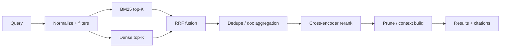

> **Research note.** This is reverse-engineering context, not the active build contract. Code snippets are illustrative; Seeky is implemented in Rust/Tauri/TypeScript. See the [implementation plan](../plans/seeky-implementation-plan.md).

# 06 — Retrieval, Ranking, and Reranking

This is the algorithm specification for the minimal app. It separates what Gety
does (verified) from what the new app should do (a deliberate improvement).

---

## 1. Pipeline overview



Default candidate counts:

```
BM25 top-K     = 100
Dense top-K    = 100
RRF output     = 50 chunks
Rerank input   = 30 chunks
Final results  = 10 documents (up to 3 chunks each)
```

---

## 2. Query normalization and filters

Before retrieval:

- Trim; reject empty/overlong queries.
- Normalize Unicode (NFKC), case-fold for matching where appropriate.
- Detect quoted phrases; pass them to FTS5 as phrases.
- Parse filters: root, extension, doc type, updated date range.
- Do **not** rewrite the query with an LLM in v1; it adds latency and failure
  modes. Add query expansion only after evaluation shows a recall gap.

Push filters into both retrievers:

```sql
-- BM25
JOIN documents d ON d.id = c.doc_id
WHERE d.root_id IN (...)
  AND d.ext IN (...)
  AND d.updated_at >= ?
```

```python
# dense
candidates = load_vectors(root_ids=..., exts=..., updated_after=...)
```

Filtering after retrieval destroys recall and wastes work.

---

## 3. BM25 / lexical retrieval

### 3.1 Why BM25

BM25 rewards term frequency with saturation and penalizes very long documents.
It is strong for names, identifiers, error codes, and exact phrases — precisely
where dense retrieval is weak.

### 3.2 SQLite FTS5

```sql
SELECT c.id,
       bm25(chunks_fts) AS bm25_score
FROM chunks_fts
JOIN chunks c ON c.id = chunks_fts.rowid
JOIN documents d ON d.id = c.doc_id
WHERE chunks_fts MATCH ?
  AND d.root_id IN (...)
ORDER BY bm25_score
LIMIT ?;
```

FTS5's `bm25()` returns a **negative** value; ascending order is best-first.
Gety converts it with `-bm25()` before weighting.

### 3.3 Tokenization

- Default: `unicode61 remove_diacritics 2` for Latin/Cyrillic/Greek.
- Chinese/Japanese: `jieba` or a trigram tokenizer. Gety uses `jieba-rs`,
  pinyin matching, and NFKC. Add this only if your corpus needs it.
- Code/identifiers: consider a trigram tokenizer or a separate exact-match
  index; BM25 on camelCase is weak.
- Keep the FTS text identical to the chunk text used for embeddings; otherwise
  lexical and semantic results diverge.

### 3.4 Query syntax

- Escape FTS5 operators in user input; allow quoted phrases.
- Support `AND`/`OR` only if you expose advanced search.
- For prefix search, use `term*` with a minimum length.
- Never interpolate raw user input into SQL; use parameters.

---

## 4. Dense retrieval

### 4.1 Embeddings

- Query and passage vectors must use the same model, dimension, and prefix
  policy.
- L2-normalize vectors; cosine similarity is then a dot product.
- Store `float32` little-endian BLOBs.

### 4.2 Exact search

For ≤100k chunks, load candidate vectors and compute a matrix–vector product:

```python
scores = matrix @ query_vec          # matrix: (N, dim), float32
top = np.argpartition(-scores, k)[:k]
top = top[np.argsort(-scores[top])]
```

Memory:

```
N=100k, dim=384, f32 → 153.6 MB
N=1M,   dim=384, f32 → 1.5 GB
N=1M,   dim=1024,f32 → 4.1 GB
```

If the matrix is too large, use i8 quantization (4× smaller) or ANN.

### 4.3 ANN later

- `sqlite-vec` `vec0`: keeps one SQLite file; metadata filters in SQL.
- `usearch`/`hnswlib`: fast in-process HNSW; persist index separately.
- Qdrant/LanceDB: separate service; only if you outgrow a single process.

ANN is approximate; measure recall against exact search before switching.

---

## 5. Fusion: Gety vs RRF

### 5.1 What Gety does

```sql
score = 0.2 * (-bm25()) + 0.8 * semantic_similarity
```

This is **weighted score fusion**. It requires the two scores to be comparable
or at least stable across queries. BM25 is unbounded and corpus-dependent;
cosine is in [-1, 1]. A fixed 0.2/0.8 weighting can work for a tuned corpus but
is brittle.

### 5.2 Recommended: Reciprocal Rank Fusion

RRF uses ranks, not raw scores:

```
RRF(d) = Σ_i  w_i / (k + rank_i(d))
```

- `k` = 60 is the standard default.
- `rank_i(d)` is 1-based; if a retriever does not return `d`, it contributes 0.
- `w_i` defaults to 1.0; try 1.2 for dense if it consistently wins.
- RRF is robust to score-scale differences and requires no calibration.

Implementation:

```python
from collections import defaultdict

def reciprocal_rank_fusion(
    rankings: list[list[int]],
    weights: list[float] | None = None,
    k: int = 60,
) -> list[tuple[int, float]]:
    if weights is None:
        weights = [1.0] * len(rankings)
    scores: dict[int, float] = defaultdict(float)
    for weight, ranking in zip(weights, rankings):
        for rank, doc_id in enumerate(ranking, start=1):
            scores[doc_id] += weight / (k + rank)
    return sorted(scores.items(), key=lambda kv: kv[1], reverse=True)
```

### 5.3 Chunk vs document fusion

- Fuse at **chunk** level so the best passage wins.
- Aggregate to document level for display:
  `doc_score = max(chunk_score) + 0.1 * sum(other_chunk_scores)`.
- Cap 2–3 chunks per document.
- Keep per-retriever ranks for debugging and UI badges.

### 5.4 When to use weighted score fusion

Only if you have a calibration set and can normalize both scores. RRF is the
safer default; weighted fusion can win slightly when tuned. Run both as an
ablation.

---

## 6. Reranking

### 6.1 Why rerank

Bi-encoders (embedding models) compare query and passage independently. A
cross-encoder reads the pair jointly and is much more accurate on the top
candidates. It is too expensive for the whole corpus, so use it only after RRF.

### 6.2 Candidate budget

| Stage | Count | Reason |
|---|---:|---|
| BM25 | 100 | Recall |
| Dense | 100 | Recall |
| RRF | 50 chunks | Dedupe/fuse |
| Rerank | 20–30 chunks | Latency/accuracy sweet spot |
| Final | 10 docs | UI/context |

### 6.3 Qwen3-Reranker-0.6B

```python
import torch
from sentence_transformers import CrossEncoder

reranker = CrossEncoder("Qwen/Qwen3-Reranker-0.6B")
pairs = [(query, c.text) for c in candidates[:30]]
scores = reranker.predict(pairs, activation_fn=torch.nn.Sigmoid())
order = np.argsort(-scores)
```

- Scores are relevance probabilities after sigmoid (or raw logits if you omit
  the activation).
- Use a custom instruction for local file search; see
  [`models-and-inference.md`](models-and-inference.md).
- Batch 8–16; truncate to 1,024–2,048 tokens.
- Timeout/fallback to RRF if the reranker is unavailable.

### 6.4 Blending

Options:

1. **Reranker only:** sort by reranker score. Simple; can be unstable for
   out-of-domain queries.
2. **Blend:** `final = α * sigmoid(rerank) + (1-α) * rrf_norm`, α = 0.7.
3. **Cascade:** rerank only if RRF top score margin is small.

Start with reranker-only; evaluate blend. Keep `rrf_rank` and `rerank_score` in
the response for transparency.

### 6.5 Reranker limitations

- Cross-encoders are slow on CPU; 0.6B may be 100–400 ms for 30 pairs.
- Long passages get truncated; rerank the best snippet/window, not the whole
  document.
- Rerankers can be fooled by keyword overlap; evaluate on your own corpus.
- They do not replace lexical search for identifiers; keep BM25 in the mix.

---

## 7. Pruning and context construction

### 7.1 What “pruning” means

After reranking, you may have more relevant text than fits in the downstream
LLM context. Pruning selects the smallest set of passages that preserves the
answer.

Gety has **no learned pruner**. Its snippets are block/offset heuristics. The
minimal app should make pruning explicit and measurable.

### 7.2 Baseline pruner (no model)

1. **Deduplicate** identical/near-identical chunks (`content_hash`, cosine >
   0.95).
2. **Document cap:** at most 2–3 chunks per document.
3. **Neighbor expansion:** add adjacent blocks around the best chunk if they
   fit the budget.
4. **MMR** for diversity:
   ```
   MMR = λ * relevance - (1-λ) * max_similarity_to_selected
   ```
   with λ ≈ 0.7.
5. **Token budget:** stop at 2,000–4,000 tokens (configurable).
6. **Keep citations:** every retained passage keeps doc ID, page, block, byte
   offsets.

### 7.3 Learned pruner (future)

- A small classifier/cross-encoder scores “is this passage necessary?”
- Train on query–passage–answer triples or weak labels from the reranker.
- Evaluate answer quality, not just nDCG; pruning can remove the one passage
  that answers the question.
- Keep it behind a flag and log when it changes the result.

### 7.4 What not to prune

- Do not prune before reranking; you will remove candidates the reranker could
  have promoted.
- Do not prune identifiers/numbers/tables aggressively; they are often the
  answer.
- Do not use the Q4 embedding-index pruning code as a context pruner.

---

## 8. Snippets and highlights

- Use the best chunk’s byte offsets to locate the passage in the document.
- Split into sentences; select the sentence(s) containing the most query terms,
  then expand to a readable window (200–400 chars).
- Highlight exact term matches; for semantic-only matches, highlight the
  sentence with the highest similarity.
- Return page number and bbox when available (PDF) or sheet/row/col (spreadsheet).
- For DOCX/HTML, return block ID + character offsets; for plain text, byte
  offsets.

---

## 9. Evaluation

### 9.1 Build a small gold set

- 50–200 queries representative of real use (names, concepts, dates, codes).
- For each query, label relevant document IDs and, where possible, the
  supporting chunk/page.
- Include multilingual and long-document queries if your corpus has them.
- Keep a held-out set; do not tune on all of it.

### 9.2 Metrics

| Metric | What it measures |
|---|---|
| Recall@k | Did the retriever find the relevant docs in the top k? |
| MRR@10 | How early is the first relevant result? |
| nDCG@10 | Graded ranking quality. |
| p50/p95 latency | Interactive feasibility. |
| Rerank lift | nDCG delta vs RRF. |
| Prune loss | Answer-quality delta vs no pruning. |

### 9.3 Ablations

Run the same gold set through:

1. BM25 only
2. Dense only
3. Weighted 0.2/0.8 (Gety-style)
4. RRF
5. RRF + reranker
6. RRF + reranker + pruner

Publish the table in the repo. This is how you justify the extra complexity.

### 9.4 Logging (privacy-aware)

- Log query hash, latency, retriever counts, top doc IDs, and user clicks.
- Do not log document text or full paths by default.
- Make logs local and opt-in.

---

## 10. Recommended default configuration

```yaml
retrieval:
  bm25_top_k: 100
  dense_top_k: 100
  rrf_k: 60
  rrf_weights: [1.0, 1.0]
  fuse_at: chunk
  max_chunks_per_doc: 3
  final_chunks: 30

reranker:
  enabled: true
  model: Qwen/Qwen3-Reranker-0.6B
  top_k: 30
  batch_size: 8
  max_length: 1024
  timeout_ms: 500
  blend_alpha: 1.0   # start with reranker-only

pruner:
  enabled: true
  mode: heuristic
  token_budget: 3000
  mmr_lambda: 0.7
  dedupe_cosine: 0.95

evaluation:
  metrics: [recall@10, mrr@10, ndcg@10, p95_latency_ms]
```

---

## 11. Failure modes and fixes

| Symptom | Likely cause | Fix |
|---|---|---|
| Exact identifiers missed | Dense-only ranking | Keep BM25; weight lexical higher for code/ID queries. |
| Semantic misses synonyms | BM25-only | Keep dense; check prefix/model. |
| Results duplicate the same doc | No document aggregation | Cap chunks/doc; aggregate by doc. |
| Reranker slow | Too many candidates/CPU | Rerank top 20; batch; GPU/ONNX. |
| Reranker hurts | Domain mismatch | Evaluate; fall back to RRF; blend. |
| Pruner drops answer | Aggressive budget/MMR | Increase budget; keep best chunk; evaluate. |
| FTS query syntax errors | Raw user input | Escape/quote; validate. |
| Stale results | No incremental update | Watcher + content hash; reindex changed docs. |

---

## 12. Bottom line

Gety proves that a desktop app can deliver hybrid retrieval with SQLite + FTS5
+ embeddings and no external vector DB. It does **not** implement RRF, a
reranker, or a pruner. The minimal app should:

- reproduce the storage/retrieval foundation,
- replace fixed 0.2/0.8 fusion with RRF,
- add a cross-encoder reranker over a small candidate set,
- add a deterministic pruner first, and
- measure every step on a gold set.
